<h1 align="center">Hi 👋, I'm Amrina Rasyada (Asya)</h1>
<h3 align="center">A passionate C# &amp; .NET developer who loves coding &lt;3</h3>

<!-- Opsional: ilustrasi coding di kanan seperti di video. Ganti URL_GIF_KAMU lalu hapus tanda komentar.

-->

  

- 🔭 I'm currently learning **C#, .NET & Cloud**
- 💻 I love coding and building new things
- ⚡ Fun fact: **I love coding <3** 😄

<h3 align="left">Connect with me:</h3>

<h3 align="left">Languages and Tools:</h3>

  

  

  

